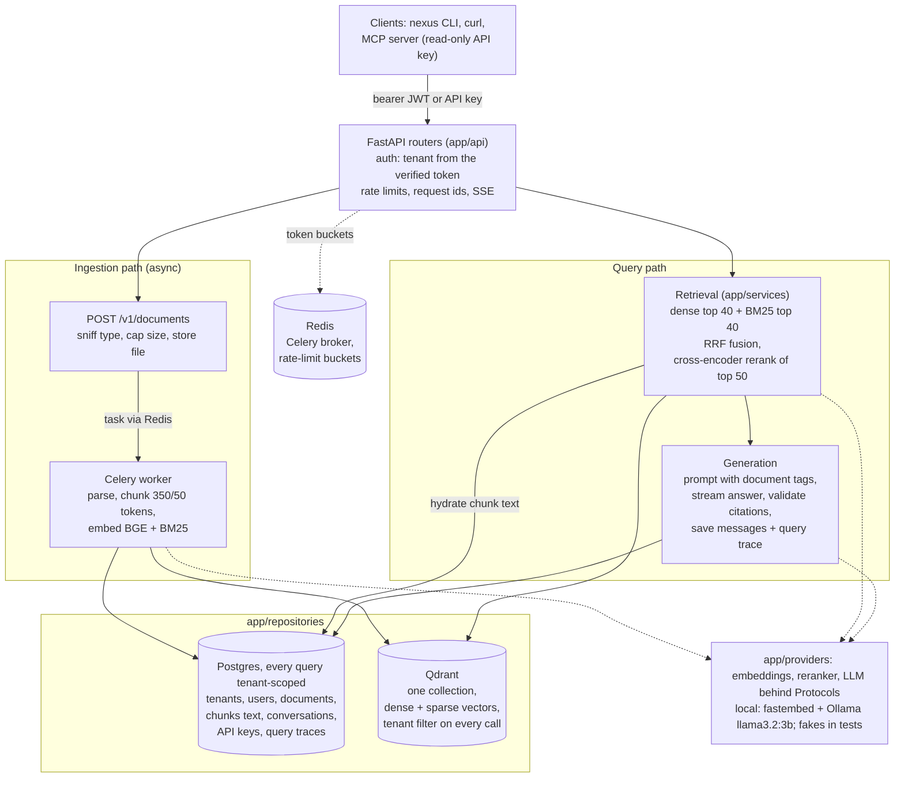

# Nexus RAG

A multi-tenant document Q&A API, backend only. Each tenant uploads documents (PDF, HTML,
Markdown, text) and gets back cited answers from its own documents only. It does hybrid
retrieval (BGE dense + BM25 sparse, RRF fusion, a cross-encoder reranker), streams answers
over SSE with citations checked against what was retrieved, and keeps multi-turn
conversations with query rewriting.
- **Operations:** an evaluation harness with a locked dataset, JSON logs and per-answer query
  traces, and a read-only MCP server so agents can use it as a tool.
- **Stack:** FastAPI, async SQLAlchemy + Postgres, Qdrant, Celery + Redis.
- **Free and local:** fastembed models and Ollama (llama3.2:3b), on CPU. Anthropic is an
  optional provider behind the same interface.

## Architecture



- Layer rules are enforced by `.importlinter`, run by `make lint`: routers in `app/api`,
  logic in `app/services`, and all SQL and Qdrant calls in `app/repositories`.
- The tenant always comes from the verified token, never from a request
  ([security.md](docs/security.md)).

## Run it

You need Docker, uv, and Ollama with `llama3.2:3b` (for answers only; search works without
it).

```bash
cp .env.example .env        # local defaults; add JWT_SECRET=... before any non-local use
make up                     # postgres, redis, qdrant
make fetch-models           # BGE, BM25, reranker and tokenizer into ./data (~1.3 GB, once)
make migrate
make dev                    # API on http://localhost:8000 (OpenAPI at /docs)
make worker                 # in another terminal: ingestion
```

The first `uv run` (inside `make fetch-models`) creates `.venv` from `uv.lock`; no separate
install step is needed. `make fetch-models` also makes the model cache readable by the
container user (some hub files are written 0600).

**Or run the app in containers** (ADR-0015):
- `make app-up` builds the image and starts `migrate`, `api` and `worker` against the same
  infrastructure, with the model caches mounted read-only. `make app-down` stops only those.
- **Verified from a fresh clone** on 2026-10-13: `git clone` of `0a747da` into an empty
  directory, with no `.env`, `data/` or `.venv`, and an empty Hugging Face cache.
  - **Steps and times:** `cp .env.example .env`; `make up` (4 s); `make fetch-models` (484 s,
    real downloads, 1.3 GB); `make migrate` (6 s).
  - **Local path** (`make dev` + `make worker` + the CLI): health OK in 9 s; signup 201;
    upload `05_README.md` ready in 7.4 s; search 27 s (reranked, uncached).
  - **Container path** (`make app-up`, 137 s including the image build): a PDF ingested by
    the containerised worker was ready in 26 s, and search found the right chunk.
  - **Caveats:** the Docker base images and uv's package cache were already on this machine,
    so `make up` and the venv install (0.7 s) were faster than on a new machine.
  - **One fix:** that run found a "Permission denied" warning (0600 cache files) on the
    container's model mount. `make fetch-models` now fixes the modes, verified in the same
    clone.

**Tests:**
- `make lint` (ruff, mypy --strict, import contracts);
- `make test` (732 unit tests, fakes only);
- `make test-int` (413 integration tests against the local services).

## A 60-second demo (CLI)

The `nexus` CLI ships with the package (ADR-0010). It has no signup command, so create a
tenant with `POST /v1/auth/signup` first.

```bash
nexus --api-url http://localhost:8000 login --email you@example.com --password-stdin
nexus upload guide.pdf --wait           # ready when the worker has chunked and embedded it
nexus docs
nexus search "how long are readings kept"
nexus ask "How long are readings kept?" # streams a cited answer from your documents
nexus history
```

A real, timed run of these commands is in [docs/cli-demo.md](docs/cli-demo.md).
A 5-minute demo script (signup, upload, search, a streamed answer, tenant isolation, the MCP
server), with the real output of one run, is in [docs/demo.md](docs/demo.md).

## Use it from an agent (MCP)

`python -m app.mcp_server` exposes `search_documents` and `list_documents` over stdio. It
uses a read-only, tenant-bound API key; there is no tenant argument. Setup, Claude Code
registration and a real verification run are in [docs/mcp.md](docs/mcp.md).

## Debug an answer

Every chat answer and conversation turn writes a query trace:
- the question and rewritten query;
- candidate ids and scores per retrieval stage, never document text;
- latency per stage, model and answer.

An admin can fetch it with `GET /v1/traces/{X-Request-ID}`. Users rate their answers with
`POST /v1/messages/{id}/feedback`. Logs are JSON lines with `request_id` and `tenant_id`
([ADR-0013](docs/decisions/0013-observability-logs-and-query-traces.md)).

## Evaluation (M8, M10): measured results

All numbers come from `eval/runs/*` (committed) and are one run each on one corpus. Details,
hypotheses written before each run, and every caveat are in
[docs/decisions/eval-log.md](docs/decisions/eval-log.md). Free local stack only: BGE + BM25
via fastembed, bge-reranker-base, Ollama llama3.2:3b, on CPU.

**Dataset v1** (locked, sha256-pinned): 60 questions over a frozen 22-file corpus (473 chunks
at 350 tokens). Split once (seed 20261010) into **48 dev** (41 answerable, 7 unanswerable) and
**12 hold-out** (10 answerable, 2 unanswerable). Gold labels are text spans. Every choice was
made on dev; the hold-out was run once, at the end.

**Retrieval**: questions with full recall in the top k, plus MRR and nDCG@10 over the
answerable questions.

| run (dev unless noted) | R@1 | R@3 | R@5 | R@10 | MRR | nDCG@10 |
|---|---|---|---|---|---|---|
| E0 dense | 14/41 | 23/41 | 24/41 | 31/41 | 0.532 | 0.595 |
| E1 sparse (BM25) | 17/41 | 22/41 | 24/41 | 25/41 | 0.546 | 0.595 |
| E2 hybrid (RRF) | 17/41 | 28/41 | 30/41 | 34/41 | 0.628 | 0.692 |
| **E3 hybrid + rerank (chosen)** | 20/41 | 27/41 | 31/41 | 34/41 | 0.635 | 0.706 |
| E3 + expand=neighbors | 21/41 | 29/41 | 32/41 | 36/41 | 0.685 | 0.745 |
| E4 chunks 200 (E3 config) | 18/41 | 24/41 | 30/41 | 34/41 | 0.596 | 0.681 |
| E4 chunks 500 (E3 config) | 20/41 | 26/41 | 30/41 | 34/41 | 0.638 | 0.704 |
| **Hold-out, E3 (final, run once)** | 5/10 | 8/10 | 9/10 | 9/10 | 0.670 | 0.732 |

- **Final configuration** ([ADR-0012](docs/decisions/0012-final-retrieval-configuration.md)):
  hybrid, candidates 40, rerank on, expand none, chunks 350/50, chat limit 6.
  - **Rerank:** lifts paraphrase R@3 from 4/10 to 8/10 and drops multi-chunk MRR from 0.719
    to 0.401; the net effect is within noise. It costs about 38 s per query on this CPU
    (median, uncached), against 0.06 s without it.
  - **Neighbors off:** with them on, 23/48 questions would lose 1-2 sources to the
    2500-token context budget.
- **Noise:** one question is 2.4 points on dev and 10 points on the hold-out. The hold-out
  isn't worse than dev; that's all n = 10 can show.

**Answer generation** (E3 config, limit 6, all 48 dev questions, llama3.2:3b), by
deterministic checks:
- **Refusals (7 unanswerable):** 4/7 exact correct refusals; 2 near-refusals (a paraphrase
  of the refusal, not counted as correct); 1 missed. 1 false refusal on 41 answerable.
- **Citations:** 40 valid and 0 invalid numeric citations; 6/40 answers uncited; 15/40 cite
  a source containing a gold span. 4 answers have malformed citations (`[pymupdf4llm]`,
  `[M6]`, `[X-Accel-Buffering: no]`, `[3]RIGHT-09`), which are now reported by the API.
- **Reference facts:** checkable in 23 answers, all found in 7, mean share 0.49. Known
  limitation: references can hold facts the question doesn't ask about.
- **Speed:** 0 errors; generation median 120 s per answer (max 230 s), first token median
  107 s.

**M10 experiments** (dev only, each with its hypothesis and decision rule committed before
the run; all kept off, so the defaults above are unchanged):

| experiment | the key numbers | decision |
|---|---|---|
| Weighted RRF, dense 1.5 or 2.0 (`RRF_DENSE_WEIGHT`) | E3 R@5 31 -> 32/41, R@10 34 -> 35/41, MRR 0.635 -> 0.639 (2 questions moved) | off: the rule needed +2 questions |
| Quote-then-cite prompt (`ANSWER_STYLE=quote_then_cite`) | cites gold 15/40 -> 21/41, uncited 6 -> 0; exact refusals 4/7 -> **0/7** | off: refusals broke |
| Refusal-first quote prompt (`quote_refusal_first`) | exact refusals 5/7; but 26/39 answers are a bare quote, false refusals 1 -> 2, cites gold 18/39 | off: failed 2 of 4 conditions ([ADR-0016](docs/decisions/0016-answer-prompt-stays-cite.md)) |

All three were measured on the same 48 dev questions that every earlier choice used; n = 7
for refusals (one question is 14 points). They are dev evidence, not a final check, which
would need a fresh labelled set (dataset v2, deferred).

**LLM judge: failed calibration, not used**
([ADR-0011](docs/decisions/0011-llm-judge-failed-calibration.md)). The one-call
llama3.2:3b judge was compared with 15 hand grades:
- correctness exact match 7/15, against 10/15 for always answering "2";
- faithfulness 8/15, against 10/15 for always answering "faithful";
- all 3 unanswerable questions scored 0, including 2 exact correct refusals;
- it never listed an unsupported claim.

**Hand grades** (one person, 15 dev answers, **n = 15**): correctness 0 / 1 / 2 =
1 / 4 / 10; faithful 10 yes / 5 no (a claim counts only if the source it cites contains it).
7/15 are fully correct and faithful.

**Bugs found along the way:**
- **Message order after a clock step** (found in M8 by a flaky `make test-int`, fixed in
  `76890d9`, ADR-0009): the WSL2/Docker clock stepped back about 0.65 s mid-turn. Messages
  ordered by wall-clock `created_at` came back answer-before-question, so a follow-up lost its
  history. `created_at` is now monotonic per conversation, under a row lock.
- **Missing `refund` in the rate-limit test stub** (found at the start of M8 by
  `make test-int`, fixed in `bdcf7f9`): 37 integration tests got a 500 on every 422 path. The
  bug was in the test harness, not the app.
- **JWT clock leeway** (found before M8, in integration tests at the M4 close, 2026-10-08;
  `5d46126`, ADR-0006): the same WSL clock steps (about 1.4 s backwards every ~30 s) made
  fresh tokens fail `iat` validation, an intermittent 401. Fixed with a 5 s leeway.
- **Found by the evaluation runs themselves:**
  - leftover `<answer>`, `</p>` and similar tags in answers, now stripped;
  - non-numeric and fused citations, now reported;
  - a fact check that ignored number words and counted `[2]` as the number 2;
  - a refusal check that missed paraphrased refusals;
  - a runner that couldn't measure `expand=neighbors`.

## Design decisions

| ADR | decision |
|---|---|
| [0001](docs/decisions/0001-pdf-parser-agpl-licence.md) | pymupdf4llm for PDFs (AGPL) |
| [0002](docs/decisions/0002-embedding-stage.md) | the embedding stage, fastembed models and delete ordering |
| [0003](docs/decisions/0003-retrieval-switches-and-fusion.md) | retrieval switches, standalone RRF and neighbor expansion |
| [0004](docs/decisions/0004-search-returns-only-ready-documents.md) | search returns only ready documents |
| [0005](docs/decisions/0005-search-debug-is-admin-only.md) | search debug is admin-only |
| [0006](docs/decisions/0006-jwt-clock-skew-leeway.md) | 5 s JWT clock-skew leeway |
| [0007](docs/decisions/0007-prompt-injection-defence.md) | prompt-injection defence in four layers |
| [0008](docs/decisions/0008-chat-sse-event-schema.md) | the chat SSE event schema |
| [0009](docs/decisions/0009-conversation-memory-and-query-rewriting.md) | conversation memory, rewriting, ownership and ordering |
| [0010](docs/decisions/0010-api-conventions-and-rate-limiting.md) | API conventions, rate limiting and the CLI |
| [0011](docs/decisions/0011-llm-judge-failed-calibration.md) | the 3B LLM judge failed calibration and isn't used |
| [0012](docs/decisions/0012-final-retrieval-configuration.md) | the final retrieval configuration |
| [0013](docs/decisions/0013-observability-logs-and-query-traces.md) | JSON logs, request traces and query traces |
| [0014](docs/decisions/0014-mcp-server-and-read-only-api-keys.md) | the MCP server and read-only API keys |
| [0015](docs/decisions/0015-container-image-and-compose-profile.md) | the container image and compose profile |
| [0016](docs/decisions/0016-answer-prompt-stays-cite.md) | the answer prompt stays `cite`; quote styles kept as settings |
| [0017](docs/decisions/0017-project-licence-agpl.md) | the project is licensed AGPL-3.0-or-later |

Dependencies and why each was added: [dependencies.md](docs/decisions/dependencies.md).

## Tenant isolation

The tenant comes only from the verified token. Every repository query and every Qdrant call
is scoped by it, and composite foreign keys tie owners to their tenant.

The tests for this:
- cross-tenant search, reads, chunks and deletes;
- conversation IDOR;
- an inspection of every vector-store search and delete;
- API keys refused outside their read allowlist.

[docs/security.md](docs/security.md) lists every control with its `file:line` and the test
that proves it, and the known gaps.

## Limitations (measured or known)

- **Slow on CPU:** retrieval with the reranker is about 38 s per query (median, uncached),
  and a llama3.2:3b answer about 120 s (median), so a chat answer takes minutes. Search
  without the reranker is 0.06 s.
- **Answer quality:** measured only by deterministic checks and 15 hand grades; the small
  LLM judge failed calibration.
- **Hold-out:** 12 questions, so it can only show the configuration didn't collapse.
- **Most common failure** (failure analysis): context use, in 14 of 26 failing dev
  questions. The gold source was in the prompt, but the answer ignored or misread it; in 8
  of the 14 it cited a different source
  ([failure-analysis.md](docs/decisions/failure-analysis.md)). Two prompt fixes were tried
  in M10. Neither passed its rule with llama3.2:3b: quoting improved grounding but broke
  refusals, or left bare quotes.
- **Dev reuse:** every choice was made on the same 48 dev questions, and the 12-question
  hold-out is spent. The numbers above are not a fresh estimate.
- **Not built:** document-level ACLs, a scheduled trace purge, a per-tenant API-key cap, and
  the eval API. The deferred items are listed in [PROGRESS.md](docs/PROGRESS.md) (Later).
- **CI** (`.github/workflows/ci.yml`: lint, unit, integration) is **unverified on GitHub**.
  A clean local simulation of its steps passed.
- **Clock steps:** the dev machine's clock steps backwards. Message and conversation order
  survive it, but other lists can show a different order (security.md, known gaps).

## Licence

Licensed under the [GNU Affero General Public License v3.0 or later](LICENSE)
(AGPL-3.0-or-later); see [ADR-0017](docs/decisions/0017-project-licence-agpl.md).

- **Why AGPL:** PDF parsing uses `pymupdf4llm`, which depends on PyMuPDF, licensed under
  AGPL-3.0 ([ADR-0001](docs/decisions/0001-pdf-parser-agpl-licence.md)). Any distributed or
  hosted form of this service is bound by the AGPL either way, so the project uses the same
  licence.
- **What it means:** anyone who interacts with a modified version of this service over a
  network must be offered its source code (AGPL section 13).
- **Other dependencies** keep their own licences. [dependencies.md](docs/decisions/dependencies.md)
  records why each was added, and the licence only for some of them.
